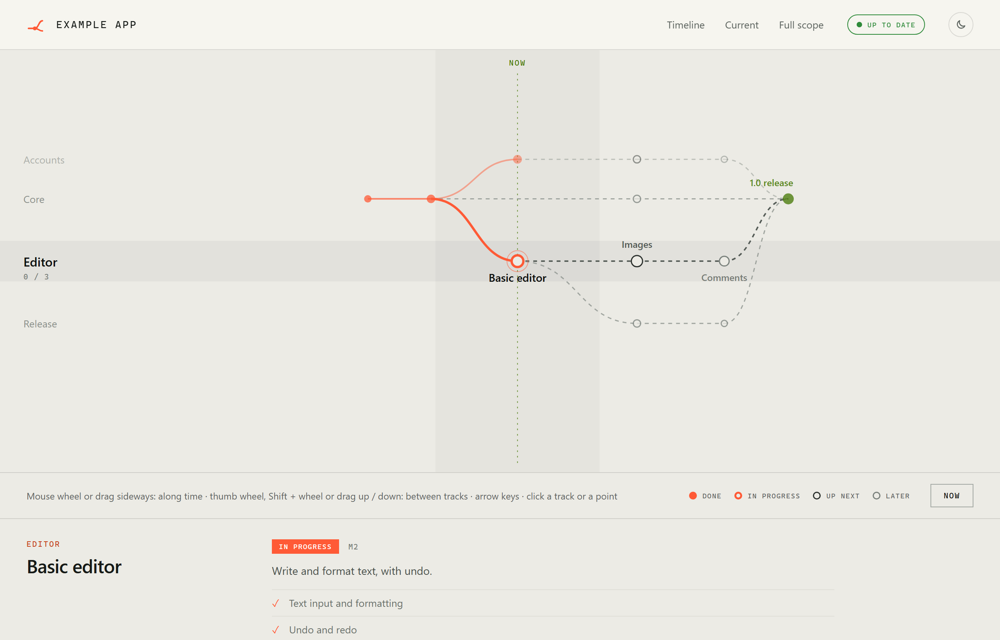
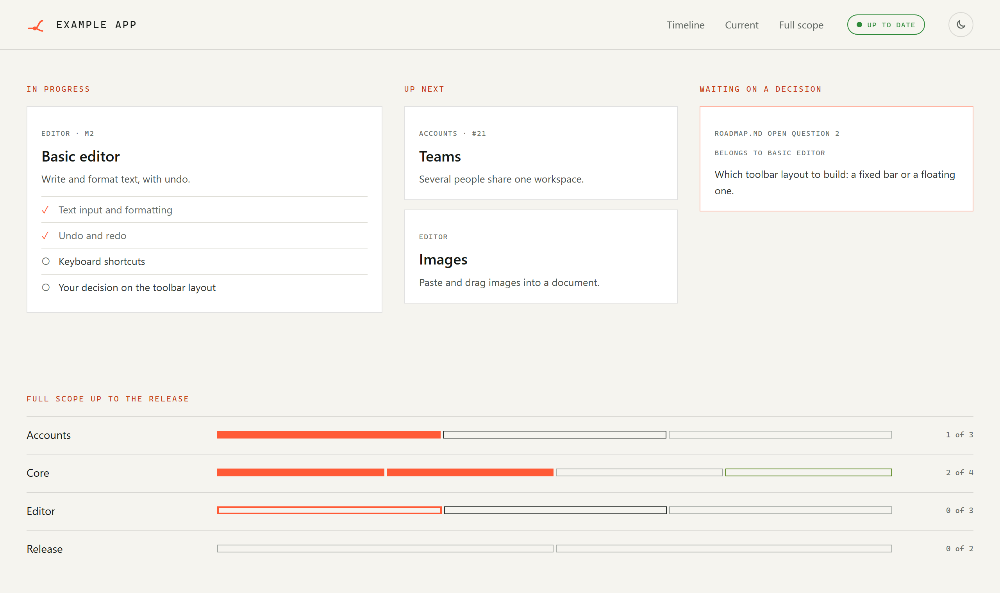

# Live roadmap

**A roadmap page for any git project that keeps itself up to date.** A timeline runs from the project start to "now"; the work ahead fans out into tracks that meet again at the release. It rebuilds from the git history on every commit, and a status pill turns orange when the plan falls behind.

[](https://github.com/FG-RVT/live-roadmap-template/archive/refs/heads/main.zip)
[](LICENSE)

<picture>
  <source media="(prefers-color-scheme: dark)" srcset="images/roadmap-dark.png">
  
</picture>

## Quick start

You need **git**, **Node.js 18+** and an AI coding agent (Claude Code, Cursor, Copilot, …).

**The lazy way:** paste this into your agent's chat, in your project:

```text
Download https://github.com/FG-RVT/live-roadmap-template/archive/refs/tags/v0.1.0.zip, unzip it into this project's root and follow live-roadmap-template-0.1.0/AI_SETUP.md. Afterwards, delete the ZIP and that folder.
```

**Or by hand:**

1. **Download** the ZIP above and unzip it into the root folder of your project. The folder ignores itself, so it never ends up in your commits.
2. **Ask your AI agent:**
   > Read `live-roadmap-template-main/AI_SETUP.md` and set up the live roadmap for this project.
3. **Answer its few questions**, check its report, then open the page it names in a browser.

That's it. The agent reads your documents and merge history, writes the plan, and installs the page and the git hooks. From then on the page updates itself after every commit, and later AI sessions keep the plan true.

**Just for you, or for the team?** The agent asks. **Local** keeps everything in a `.roadmap/` folder that git ignores, so your repository stays untouched. **Shared** commits the roadmap so teammates, CI and a published page get it too.

## What you get



- **Timeline:** finished work on the left, open work fanning out to the right, "now" in between.
- **Current work:** what is in progress (with a checklist), what comes next, and what waits on a decision.
- **Full scope:** one bar per track, all the way to the release.
- **Status pill:** green when the plan matches git, slowly pulsing orange when something needs a look. Hover it for the details.
- **Always current:** an open page picks up new data every minute, without a reload.
- **Light and dark mode**, English and German, no dependencies. It's plain static files, so it also works when opened straight from disk.

## Try it first

To see the page with the example plan before installing anything, run this inside the unzipped folder and open `install/docs/roadmap/roadmap.html`:

```bash
node install/tools/roadmap/build.mjs --plan example/roadmap-live.json --out install/docs/roadmap --no-git
```

## Using the page

Mouse wheel or drag sideways to move along time · Shift + wheel (or a thumb wheel) or drag up/down to switch tracks · arrow keys work too · **Now** jumps back to the current work · click any point, card or bar to focus it.

## What's inside

| Path | What it is |
| --- | --- |
| `AI_SETUP.md` | Setup instructions for the AI agent |
| `install/` | Everything that goes into your project, laid out as it lands there: the builder, the page, the git hooks |
| `example/roadmap-live.json` | An example plan |
| `snippets/agent-rule.md` | The rules the agent adds to your project's AI instructions |

## License

[MIT](LICENSE)
